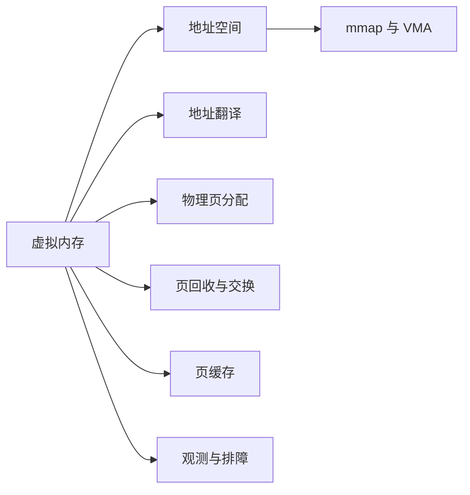
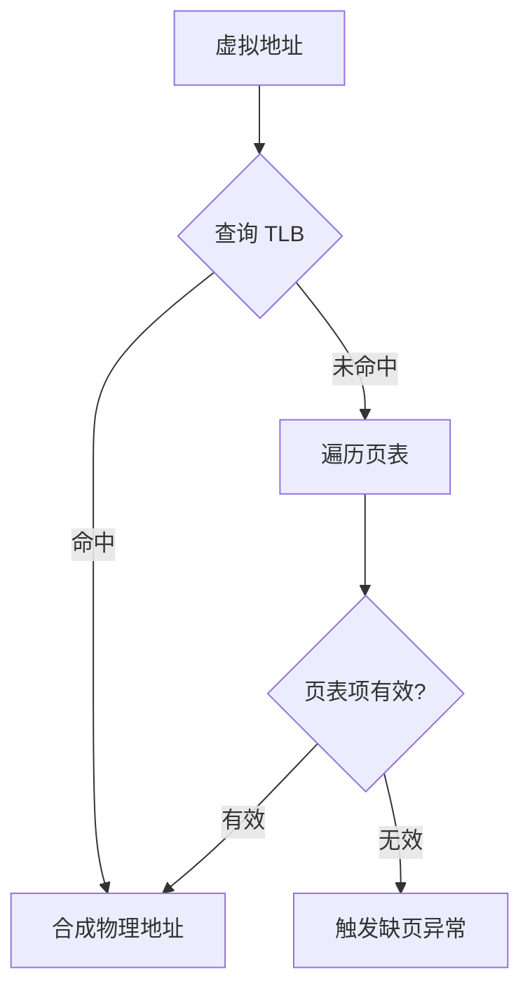
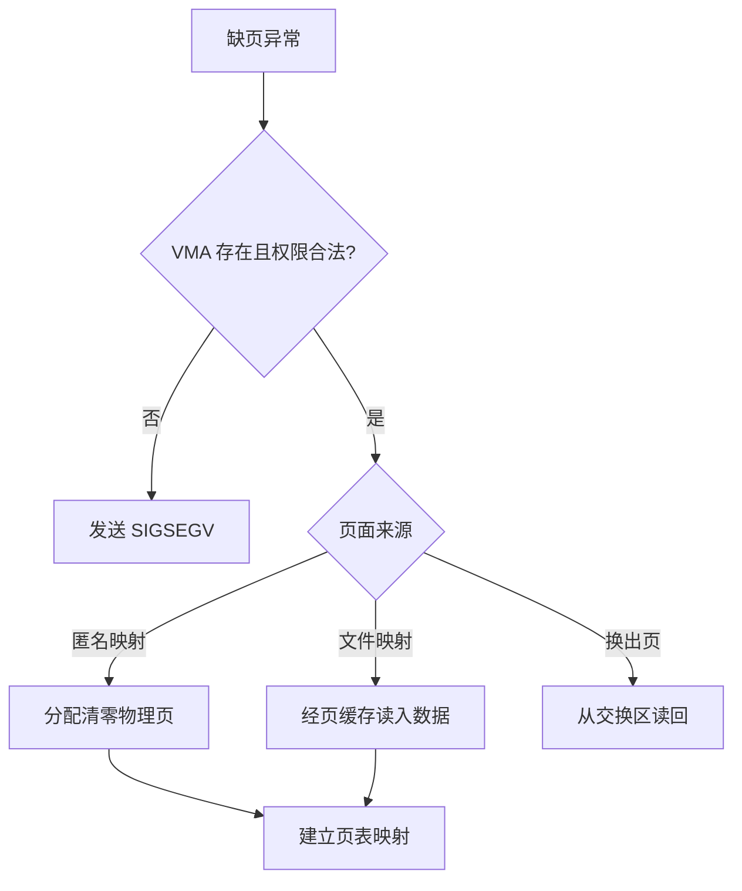
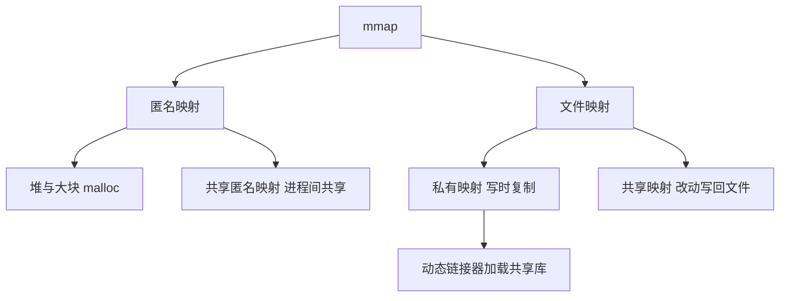
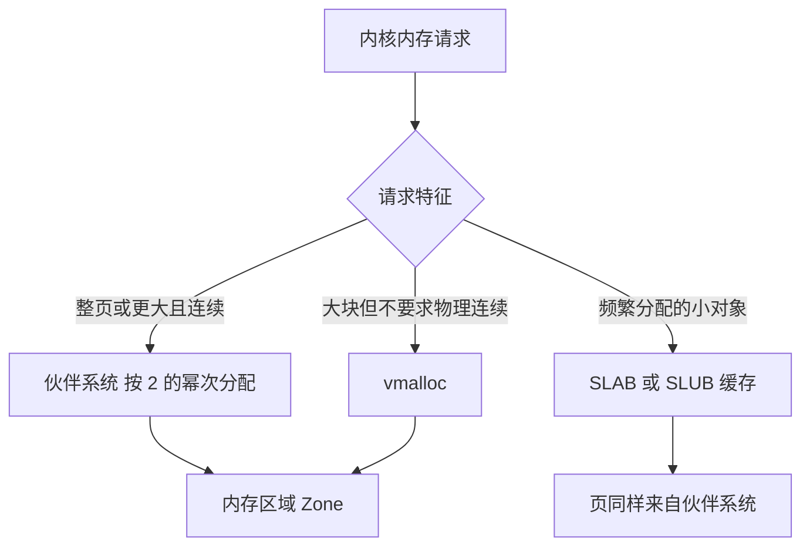
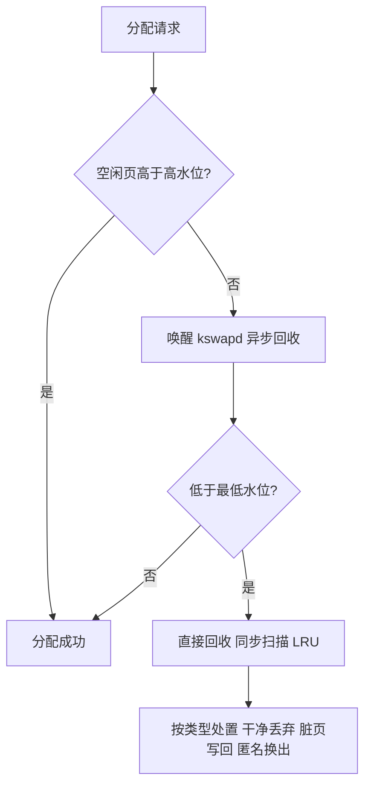
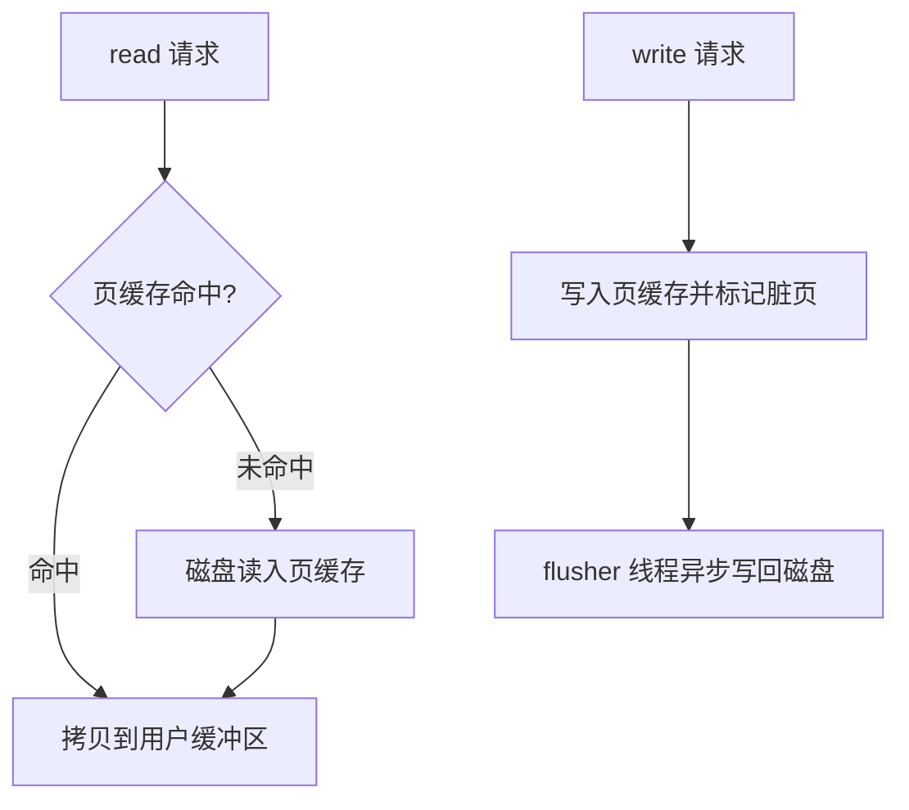
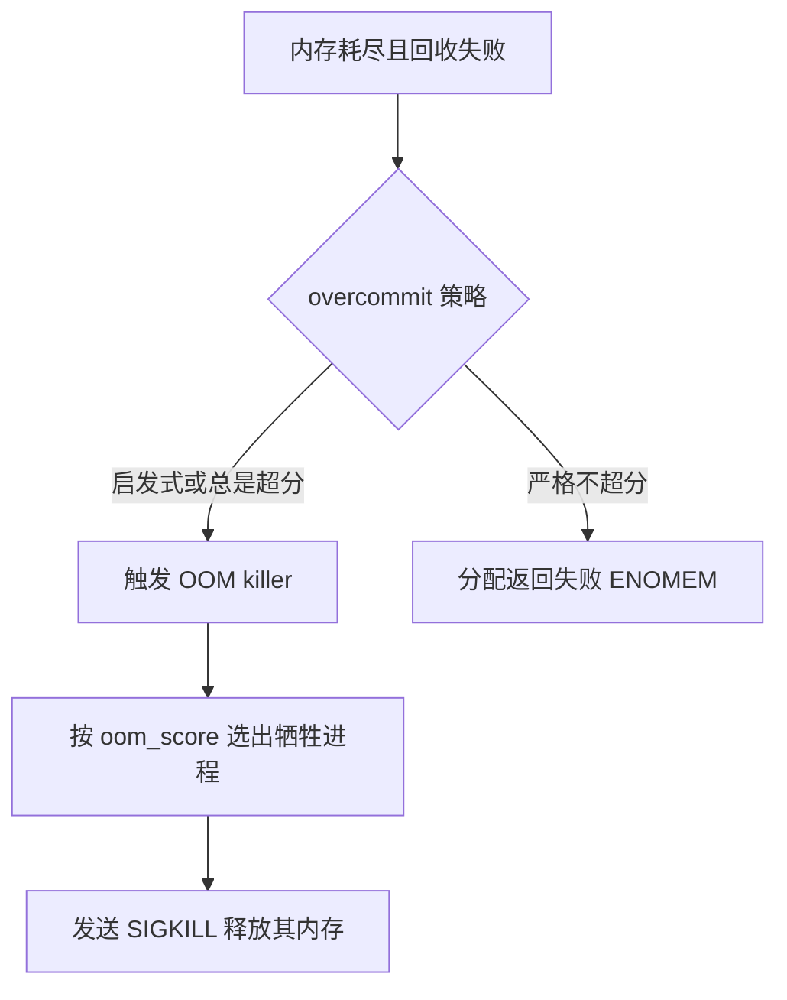

# Linux 虚拟内存学习笔记

> 面向开发者的系统知识笔记。核心组织方式是回答三个问题：每个机制**为什么存在**、**解决了什么问题**、**什么场景会遇到**。默认描述 x86-64 平台上的通用原理，涉及版本差异处会单独标注内核版本。

---

## 1. 为什么需要虚拟内存

假设没有虚拟内存，所有进程直接在物理内存上工作，会立即遇到四个无法回避的问题：

| 问题 | 后果 | 虚拟内存的解法 |
| --- | --- | --- |
| 进程间无隔离 | 一个程序写越界可踩坏别的程序甚至内核 | 每个进程独立地址空间，互相不可见 |
| 物理内存不够用 | 程序总大小被 RAM 硬限制 | 按需调页加交换，内存可以超分配 |
| 装载地址不固定 | 程序链接时无法知道自己被装到哪 | 编译链接统一用虚拟地址，装载位置自由 |
| 内存碎片化 | 连续大空闲块难找，大数组分配失败 | 虚拟连续即可，物理页可以离散 |

虚拟内存的本质是**一层间接**：进程看到的是连续、私有、巨大的虚拟地址空间，内核和 MMU（内存管理单元）负责在访问发生的瞬间把它翻译成真实的物理地址。这层间接换来隔离性、灵活性和可超配性，代价是翻译开销和内核管理复杂度，后面每一节都是在还这笔账。

---

## 2. 知识地图



阅读顺序建议按图从左到右：先理解进程看到的世界（地址空间），再理解硬件与内核如何翻译（页表与 TLB），然后理解访问发生时才干活的机制（缺页异常），最后到资源紧张时的行为（回收、交换、OOM）以及日常观测。

---

## 3. 进程的虚拟地址空间

### 3.1 为什么地址空间要这样划分

内核设计地址空间布局时要同时满足：装载器能快速摆放程序各部分、堆和栈都能动态增长、共享库能被映射进来、内核能被快速触达（系统调用不用切换页表）。x86-64 上典型的布局如下：

| 区域 | 大致位置 | 内容 | 增长方向 |
| --- | --- | --- | --- |
| 代码段 text | 低地址 | 可执行指令 | 固定 |
| 数据段 data 与 bss | 紧随其后 | 已初始化与未初始化全局变量 | 固定 |
| 堆 heap | 数据段之上 | malloc 等小对象分配 | 向上 |
| mmap 区 | 地址空间中上部 | 共享库 文件映射 大块 malloc | 向下 |
| 栈 stack | 用户空间顶部 | 函数调用帧 局部变量 | 向下 |
| 内核空间 | 地址空间最高 128 TiB | 内核代码与数据 | 用户态不可访问 |

经典 x86-64 四级页表下虚拟地址为 48 位，用户态和内核态各占 47 位可寻址范围：

$$
2^{47}\ \mathrm{B} = 128\ \mathrm{TiB}
$$

需要更大地址的机器可启用五级页表（LA57，内核编译选项 CONFIG_X86_5LEVEL），虚拟地址扩展到 57 位，用户空间上限随之扩大约 512 倍（见内核文档 x86/x86_64/5level-paging）。

### 3.2 亲眼看到布局：/proc/pid/maps

地址空间不是抽象概念，每个进程的布局可以直接查看：

```bash
cat /proc/self/maps | head -20
```

```text
55a3f1c00000-55a3f1c01000 r--p 00000000 08:01 524300  /usr/bin/cat
55a3f1c01000-55a3f1c05000 r-xp 00001000 08:01 524300  /usr/bin/cat
55a3f2900000-55a3f2b10000 rw-p 00000000 00:00 0       [heap]
7f2b8c000000-7f2b8c021000 rw-p 00000000 00:00 0
7f2b8e5a0000-7f2b8e5c2000 r--p 00000000 08:01 531841  /usr/lib/x86_64-linux-gnu/libc.so.6
7ffd0e0f0000-7ffd0e111000 rw-p 00000000 00:00 0       [stack]
```

每一行就是一个 **VMA（虚拟内存区域）**，列含义：

| 列 | 含义 |
| --- | --- |
| 地址范围 | 起始-结束虚拟地址 |
| 权限 | r w x 加 p 私有或 s 共享 |
| 偏移 | 文件映射时在文件内的偏移 |
| 设备与 inode | 映射文件所在位置 匿名页为 0 |
| 路径 | 映射的文件名 或 [heap] [stack] 等特殊段 |

注意权限列的 `p`：程序文件的代码段映射成私有映射，多个进程跑同一个程序时**共享同一份物理页**，这就是虚拟内存省内存的第一个日常例子。

---

## 4. 地址翻译：页、页表与 TLB

### 4.1 为什么用页而不是字节管理

逐字节记录映射需要天文数字的表项，连续的大段管理又退化为分段式的碎片问题。折中方案是把内存切成固定大小的块，x86-64 默认 4 KiB 一页，虚拟页（page）映射到物理页帧（page frame）。地址被拆成两部分：

$$
VA = VPN \times 2^{12} + offset,\qquad PA = PFN \times 2^{12} + offset
$$

翻译只替换页号部分，页内偏移原样保留。4 KiB 是硬件效率与表大小的历史平衡点，大页（2 MiB 与 1 GiB）的存在则是为了进一步压缩表项数量，见第 12 节。

### 4.2 为什么是四级页表

如果页表是一张扁平数组，48 位地址需要 $2^{36}$ 个表项，每个进程一张，显然不可行。页表因此做成**稀疏的多级树**：虚拟地址被切成若干段索引，逐级查表，未使用的中间层整棵子树可以不分配。x86-64 四级页表的索引层依次是 PGD、P4D、PUD、PMD，最后一级 PTE 指向物理页。程序实际用到的地址范围通常很小，所以树很浅很省。

### 4.3 翻译流程与 TLB

每级查表都是一次内存访问，四级页表意味着一次访存最坏变成五次，不可接受。TLB（旁路转换缓存）就是为解决这个性能问题而存在的页表项高速缓存：



实际命中率很高（局部性原理），翻译开销通常可忽略。需要记住的三个推论：

- **进程切换要刷 TLB**，因为同样的虚拟地址在不同进程含义不同。内核用 PCID 特性给 TLB 项打进程标签来缓解。
- **访问未映射地址不是翻译慢而是直接异常**，这是段错误（SIGSEGV）的硬件来源。
- **TLB 容量有限**，随机访问大内存的负载会因 TLB 抖动明显变慢，这正是大页存在的理由。

---

## 5. 缺页异常与按需调页

### 5.1 为什么分配可以"先记账后付款"

进程 malloc 或 mmap 成功时，内核**只更新了地址空间的账本（VMA），并没有分配物理页**。物理页要等第一次真正访问时才分配，这叫按需调页（demand paging）。这样设计解决三个问题：

- 程序申请的内存很多但从不用（典型如大型稀疏结构），按需分配避免浪费。
- 进程启动快，不用等整个程序从磁盘读入。
- fork 可以极快完成：父子进程先共享所有页，谁写谁复制（写时复制 COW）。

### 5.2 缺页异常的处理流程

访问一个尚未建立映射的页时，CPU 触发缺页异常（page fault），内核异常处理程序接管：



处理完成后 CPU 重新执行刚才那条指令，进程对整个过程无感知。这就是"虚拟"二字的完整闭环：进程以为内存一直在那里，实际是异常处理程序临场布置的。

### 5.3 缺页的分类与观测意义

| 类型 | 含义 | 代价 | 场景提示 |
| --- | --- | --- | --- |
| minor fault | 页在内存中但尚未映射 如清零页 COW | 微秒级 | 正常 无需关注 |
| major fault | 页不在内存 需磁盘 IO 读入 | 毫秒级 | 内存紧张或冷数据被访问 |

`/proc/pid/stat` 的 minflt 与 majflt 字段、`ps -o min_flt,maj_flt` 都能看到这两个计数。major fault 突增通常意味着工作集超过了可用内存，服务延迟会随之抖动。

---

## 6. 内核如何管理地址空间：VMA

每个进程的地址空间在内核中由一个 `mm_struct` 描述，其中的 VMA 集合（每个 VMA 是一个 `vm_area_struct`）记录了"哪段虚拟地址有效、什么权限、背后是什么（文件或匿名）"。缺页处理、mmap、mprotect、fork 全都依赖快速查找和修改 VMA，因此 VMA 的存储结构直接影响性能。

关键演进（版本敏感）：

| 版本 | 变化 | 动机 |
| --- | --- | --- |
| 6.1 之前 | 红黑树加双向链表 | 查找与遍历两份结构 维护复杂 |
| 6.1 | 改用 maple tree | 一种按范围索引的 B 树变体 统一查找与遍历 并为细粒度锁铺路 |
| 6.5 | per-VMA lock | 缺页处理可只锁单个 VMA 缓解多线程进程的 mmap_lock 竞争 |

`mmap_lock` 是这个子系统最著名的瓶颈：它是进程级的读写信号量，所有缺页处理都要拿读锁，而 mmap 与 munmap 要拿写锁。多线程程序高并发缺页时，一个线程的 mmap 会卡住所有线程的缺页处理。per-VMA lock（6.5 起）让常见缺页路径只锁住目标 VMA，是多线程负载的重要改进（见内核文档 mm/process_addrs）。

---

## 7. mmap：文件映射与匿名映射

### 7.1 为什么需要 mmap

传统 read/write 路径里，数据要从磁盘到页缓存、再从页缓存拷贝到用户缓冲区，并且每次 IO 都是一次系统调用。mmap 把文件直接映射进地址空间后：

- **少一次拷贝**：进程直接读写页缓存所在的物理页。
- **IO 变成访存**：读文件由缺页异常驱动，写文件由脏页回写驱动，无需逐次系统调用。
- **天然共享**：多个进程映射同一文件即得到共享内存，是进程间通信的经典手段。
- **装载器基础**：动态链接器加载 .so 就是 mmap 私有映射，全系统共享一份库代码页。



### 7.2 关键 API 与标志

```c
#include <sys/mman.h>

void *mmap(void *addr, size_t length, int prot, int flags,
           int fd, off_t offset);
int munmap(void *addr, size_t length);
int madvise(void *addr, size_t length, int advice);
int mprotect(void *addr, size_t len, int prot);
```

| 标志组合 | 语义 | 典型场景 |
| --- | --- | --- |
| MAP_PRIVATE 文件 | 读共享 写时复制 | 加载共享库 只读访问文件 |
| MAP_SHARED 文件 | 改动对所有映射者可见并写回 | 进程间通信 内存数据库 |
| MAP_PRIVATE 匿名 | 私有清零页 | malloc 大块 线程栈 |
| MAP_SHARED 匿名 | 亲缘进程共享 | fork 配合的父子进程通信 |

`madvise` 是应用给内核的"使用模式提示"，常见值：`MADV_SEQUENTIAL`（加大预读）、`MADV_RANDOM`（关闭预读）、`MADV_DONTNEED`（立即回收这段页）、`MADV_HUGEPAGE`（请求透明大页）。Redis、数据库这类对 IO 模式有明确认知的程序普遍使用它。

完整语义见 man 手册 mmap(2) 与 madvise(2)。

---

## 8. 物理页分配：伙伴系统、SLAB 与 vmalloc

进程看到的是虚拟地址，内核自己也需要物理内存，而且不同需求互相矛盾：设备 DMA 要物理连续、小对象分配要省空间、大缓冲要灵活。三套机制各解决一类问题：



| 机制 | 解决的问题 | 代价 |
| --- | --- | --- |
| 伙伴系统 | 按页块分配 合并相邻空闲块对抗外部碎片 | 最小粒度一页 小请求浪费 |
| SLAB 或 SLUB | 在整页上切固定大小对象 消除内部碎片 缓存常用对象 | 缓存种类多 需调优 |
| vmalloc | 用页表拼出虚拟连续的大块 物理页可离散 | 每次访问多查一层页表 TLB 压力大 |

为什么小对象不能直接用伙伴系统：一个几十字节的 inode 结构占一整页 4 KiB，内核里这类对象以百万计，内存会大部分浪费在碎片上。SLUB（当前主流实现）本质是"批发加零售"：向伙伴系统批发整页，切成小块零售给调用者，释放后留在缓存里下次直接复用。`kmalloc` 就是建立在 SLUB 之上的通用小内存接口。

`/proc/slabinfo` 和工具 `slabtop` 可以查看各类 SLAB 缓存的占用，内核内存泄漏排查常从这里入手。

---

## 9. 内存回收：LRU、kswapd 与交换

### 9.1 为什么需要回收

按需调页意味着物理页迟早被分完。此时内核必须腾出空间，可处置的页分三类：干净文件页直接丢弃（需要时再从磁盘读）、脏文件页先写回再丢弃、匿名页没有文件可回只能写入交换区（swap）。回收机制的核心问题是**挑谁**：理想目标是"最近不会再用的页"，实用的近似是"最近最少使用的页"，即 LRU。

### 9.2 水位线与两条回收路径

内核给每个内存区域设了三条水位线（min、low、high），分配路径的行为随空闲量变化：



- **kswapd** 是后台内核线程，在压力尚小时提前回收，让分配路径尽量顺畅。
- **直接回收（direct reclaim）** 是分配路径上的进程被迫自己扫描回收，这是内存压力下服务延迟毛刺的直接原因之一。
- 回收扫描以 LRU 链表为单位，经典实现按匿名与文件、活跃与不活跃分四条链表；**6.1 起可选 MGLRU（多代 LRU）**，把页按"代龄"分成多组，回收决策更精确，内存压力下性能明显更好（见内核文档 admin-guide/mm/multigen_lru）。

### 9.3 交换：用磁盘换生存时间

swap 的存在是为了让系统在内存峰值时**降级运行而不是直接崩溃**：冷的匿名页（如久未触碰的堆数据）被写到磁盘，腾出 RAM 给热数据。代价是磁盘比内存慢几个数量级，一旦热页也被迫换出，系统进入"抖动"（thrashing），每次访问都触发 major fault。

实践要点：

- 有 swap 时观察 `vmstat` 的 si 与 so 列（换入换出速率），持续非零说明内存不足。
- `vm.swappiness`（0 到 200）调节内核换出匿名页的倾向，不是开关；即使设为 0，内存耗尽时仍会交换。
- 延迟敏感服务常配合 cgroup 内存限制并谨慎设置 swap，宁可在边界上触发 OOM 也不要慢慢抖死。

---

## 10. 页缓存：内存与文件系统的桥梁

### 10.1 为什么文件 IO 默认经过内存

磁盘比内存慢三到四个数量级，而文件访问有极强的时间局部性（刚读的配置还会再读）和空间局部性（顺序读写）。页缓存（page cache）用空闲内存缓存文件内容，把这两个局部性变成命中率：



几个必须知道的事实：

- **free 显示的 used 高不等于内存紧张**：页缓存随用随占、有压即让，`free -h` 的 available 列才是"大约还能用多少"。
- **write 返回不代表落盘**：数据可能还在页缓存里，掉电即丢。需要持久性保证时用 fsync 或 O_SYNC。
- **预读（readahead）**：内核检测顺序访问后提前把后续数据读入页缓存，顺序读性能的主要来源。`madvise` 可调整此行为。
- **O_DIRECT 绕过页缓存**：数据库等自己管理缓存的程序用它避免双重缓存，但对齐和缓冲管理责任转移给应用。

页缓存也是 mmap 文件映射的物理载体，第 7 节的"少一次拷贝"正源于映射和读写共用同一份缓存页。

---

## 11. 内存超分配与 OOM Killer

### 11.1 为什么允许超分配

按需调页的世界里，进程申请的虚拟内存远大于实际会用的物理内存是常态（fork 的 COW、稀疏数组、预留空间）。如果申请时就要求物理内存足额担保，fork 一个大进程会直接失败，大量内存被闲置。Linux 因此默认**启发式超分配**（vm.overcommit_memory=0）：申请时宽松通过，赌不会同时兑现。

赌输的时刻就是 OOM：物理内存加交换全部耗尽、回收也救不回来。此时内核的选择只有两种：卡住等死，或者杀掉一些进程换系统存活。OOM killer 选择后者。



### 11.2 谁会被杀与如何保护

OOM killer 按 `oom_score` 打分，大致逻辑是"占用内存最多且可牺牲"的进程得分最高。每个进程的 `/proc/pid/oom_score_adj`（-1000 到 1000）可以人为调整：-1000 表示禁止 OOM 选中，正值加大被选概率。关键基础设施进程常调负，可牺牲的计算任务调正。

### 11.3 cgroup 下的局部 OOM

容器环境里 OOM 有两层：全局 OOM 由内核处理；cgroup 内存超限触发**该组的局部 OOM**，只杀组内进程。cgroup v2 的关键文件：

| 文件 | 作用 |
| --- | --- |
| memory.max | 硬上限 超过即回收 失败则组内 OOM |
| memory.high | 软上限 超过即主动回收并限速 |
| memory.current | 当前用量 |
| memory.events | oom 与 oom_kill 次数统计 |

容器"莫名其妙被杀"的第一排查点就是 memory.events 与 dmesg 中的 OOM 记录。

---

## 12. 大页：THP 与 hugetlb

4 KiB 页在内存动辄数百 GiB 的今天带来两个规模化问题：页表项数量庞大（1 TiB 内存需要 2.68 亿个表项），TLB 覆盖范围小（几千个表项只覆盖几十 MiB）。大页把页尺寸提到 2 MiB 或 1 GiB，一条 TLB 项覆盖范围扩大 512 倍，页表层级也减少。

| 方案 | 使用方式 | 优点 | 代价 |
| --- | --- | --- | --- |
| THP 透明大页 | 内核自动合并拆分 应用无感 | 零改动 | 内存紧张时整理大页会造成延迟毛刺 |
| hugetlb 预留大页 | 启动时预留 显式挂载使用 | 确定性强 永不回收 | 需要预留与规划 不灵活 |

THP 由 khugepaged 内核线程在后台扫描合并，控制开关在 `/sys/kernel/mm/transparent_hugepage/enabled`（always、madvise、never）。一个著名实践：Redis、MongoDB 等延迟敏感服务官方建议**关闭 always 模式**，因为大页整理引起的卡顿比 TLB 收益更疼；吞吐型计算负载则通常从 always 受益。这是"机制没有绝对好坏，只有场景匹配"的典型案例。

---

## 13. 观测工具与关键指标

| 工具或文件 | 看什么 | 关键读数 |
| --- | --- | --- |
| free -h | 全局内存概览 | available 而非 free |
| vmstat 1 | 回收与交换活动 | si so 持续非零说明内存不足 |
| /proc/meminfo | 全部计数器源头 | MemAvailable Cached SwapTotal |
| /proc/pid/status | 单进程内存 | VmRSS 常驻 VmSwap 被换出量 |
| /proc/pid/smaps | 单进程逐 VMA 明细 | Pss 按比例分摊共享页 |
| pmap -x pid | smaps 的可读汇总 | RSS 与 Dirty 分列 |
| smem | 按 PSS 统计全局 | 多进程共享库的公平计量 |
| /proc/slabinfo 与 slabtop | 内核对象缓存 | 单项异常增长提示内核泄漏 |
| /proc/pressure/memory | PSI 内存压力停顿 | avg10 持续高说明回收拖累业务 |

RSS 与 PSS 的区别值得单独记：RSS 把共享库页完整算给每个进程，十个进程共享一份 100 MiB 的库会显得共占 1 GiB；PSS 把共享页按比例分摊，才是评估真实占用的公平口径。

`/proc/pid/stat` 中的 minflt 与 majflt（第 5 节）、`/proc/pressure/memory` 的 PSI（2.6 内核时代痛点在 4.20 起由 PSI 量化）是定位"内存引起的延迟"最直接的两个信号。

---

## 14. 常见误区

| 误区 | 事实 |
| --- | --- |
| free 很低就是内存不够 | Linux 刻意用空闲内存做页缓存 看 available |
| 缓存占用是被浪费的内存 | 页缓存有压力即释放 它提升的是 IO 性能 |
| malloc 成功就有了物理内存 | 只是地址空间记账 物理页首次访问才分配 |
| top 的 VIRT 大就是泄漏 | VIRT 含全部虚拟映射 很多从不兑现 看 RSS 与趋势 |
| 关闭 swap 就没有换页抖动 | 文件页仍会换出重读 且失去匿名页缓冲垫更易 OOM |
| OOM 是随机杀进程 | 按 oom_score 排序 可用 oom_score_adj 干预 |
| write 返回即数据安全 | 数据可能只在页缓存 需 fsync 保证落盘 |

---

## 15. 学习路径建议

1. 先在真实机器上跑一遍观测命令：free、vmstat、看 /proc/self/maps、用 strace 数一次程序的 mmap 与缺页，建立直觉。
2. 精读 man 手册 mmap(2)、madvise(2)、proc(5) 中 meminfo 与 smaps 小节，这是日常开发最常用的接口层。
3. 读内核官方文档 Documentation/admin-guide/mm/ 的 concepts、hugetlbpage、multigen_lru，建立机制层理解。
4. 想深入实现，读 Mel Gorman 的《Understanding the Linux Virtual Memory Manager》（对应老版本但框架不朽）配当前内核源码 mm/ 目录。
5. 关注版本演进：maple tree（6.1）、MGLRU（6.1）、per-VMA lock（6.5）这类变化说明虚拟内存子系统仍在快速演化，读 LWN 的 mm 专题跟进。

---

## 参考资料

- [Memory Management — The Linux Kernel documentation](https://kernel.org/doc/html/latest/admin-guide/mm/index.html)
- [Process Addresses — The Linux Kernel documentation](https://www.kernel.org/doc/html/v6.13/mm/process_addrs.html)
- [Multi-Gen LRU — The Linux Kernel documentation](https://docs.kernel.org/6.15/admin-guide/mm/multigen_lru.html)
- [5-level paging — The Linux Kernel documentation](https://www.kernel.org/doc/html/v5.14/x86/x86_64/5level-paging.html)
- [mmap(2) — Linux manual page](https://man7.org/linux/man-pages/man2/mmap.2.html)
- [proc(5) — Linux manual page](https://man7.org/linux/man-pages/man5/proc.5.html)
- [Per-VMA Locks — Linux Kernel Internals](https://kernel-internals.org/mm/per-vma-locks/)
- Mel Gorman《Understanding the Linux Virtual Memory Manager》（kernel.org 有公开电子版）
