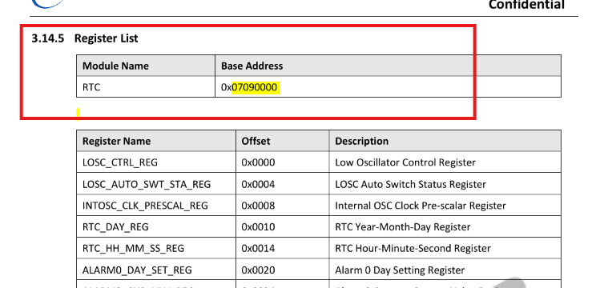

# 一个用户态的设备节点背后经历了什么

> 以 T113（`sun8iw20`）的 `/dev/rtc0` 为例，从一行 `.dts` 走到一条 `readl()`。
>
> 本文所有代码、行号均取自本仓库：
> `lichee/linux-5.4/`（Linux 5.4）与 `lichee/brandy-2.0/u-boot-2018/`（U-Boot 2018）。

---




## 0. 先看全景：一行 open() 到底穿过了什么

应用层只看到两个东西：一个路径，一个文件描述符。

```c
int fd = open("/dev/rtc0", O_RDONLY);          /* 拿到一个 fd */
struct rtc_time tm;
ioctl(fd, RTC_RD_TIME, &tm);                   /* 问硬件现在几点 */
```

但在内核里，这一来一回是这样的：

```text
[构建期]  .dts ──dtc──▶ .dtb (0xd00dfeed) ──pack──▶ boot.img
             │
             ▼
[启动期]  U-Boot: r2 = 0x41800000
             └──▶ setup_arch ──▶ unflatten_device_tree ──▶ of_root
             │
             ▼
[建模型]  of_platform_populate ──▶ platform_device("7090000.rtc")
             │
             ▼
[认领]    platform_match ──▶ sunxi_rtc_probe() ──▶ ioremap / clk / irq
             │
             ▼
[注册]    rtc_register_device() ──▶ cdev_add + device_add ──▶ devtmpfs ──▶ /dev/rtc0
             │
             ▼
[使用]    open() ──▶ namei ──▶ chrdev_open ──▶ rtc_dev_fops
             └──▶ rtc_dev_ioctl ──▶ rtc_read_time ──▶ sunxi_rtc_gettime
             └──▶ readl(chip->base + RTC_DAY_REG) ──▶ copy_to_user ──▶ 你的 tm
```

一句话：**`.dts` 描述硬件长什么样，总线让驱动和硬件配对，子系统规定接口并在 `/dev` 里生出节点，驱动负责读写寄存器。** 下面把这条路拆成六段，逐段看源码。

---

## 阶段一 🏗️ 构建图纸：`.dts` → `.dtb` → `boot.img`

### 1.1 写下硬件描述

在 `arch/arm/boot/dts/sun8iw20p1.dtsi:424`，RTC 是这样被描述的：

```dts
rtc: rtc@7090000 {
    compatible = "allwinner,sun8iw20-rtc";
    device_type = "rtc";
    wakeup-source;
    reg = <0x0 0x07090000 0x0 0x320>;
    interrupts = <GIC_SPI 144 IRQ_TYPE_LEVEL_HIGH>;
    clocks = <&r_ccu CLK_R_AHB_BUS_RTC>, <&rtc_ccu CLK_RTC_1K>, <&rtc_ccu CLK_RTC_SPI>;
    clock-names = "r-ahb-rtc", "rtc-1k", "rtc-spi";
    resets = <&r_ccu RST_R_AHB_BUS_RTC>;
    gpr_cur_pos = <6>;
};
```

这几行信息量很大，后面每一行都会在内核里找到对应的消费者：

| 属性 | 谁来读 | 用途 |
| --- | --- | --- |
| `compatible` | `of_match_table` | 决定由哪个驱动认领 |
| `reg` | `platform_get_resource()` | 寄存器基地址 `0x07090000`、长度 `0x320` |
| `interrupts` | `platform_get_irq()` | 闹钟中断号 |
| `clocks` / `clock-names` | `devm_clk_get()` | 打开总线时钟、1K 时钟、SPI 时钟 |
| `resets` | `devm_reset_control_get()` | 解除复位 |
| `wakeup-source` | `of_property_read_bool()` | 允许 RTC 作为唤醒源 |

### 1.2 编译成二进制

`dtc` 把文本 `.dts` 编译成扁平设备树 `.dtb`，文件开头是魔数 `0xd00dfeed`（大端），紧接着是总长度、结构块偏移、字符串块偏移等头部字段。

本仓库里编译产物就是 `lichee/linux-5.4/arch/arm/boot/dts/board.dtb`。

`.dtb` 不是代码，也不是配置文件，它本质上是**一块被打包成结构化二进制的内存快照**：所有节点、属性、字符串按固定布局排列。内核启动时要做的，就是把这坨"扁平"的数据重新展开成可以指针遍历的树。

### 1.3 打包进固件

`pack` 工具把 U-Boot、内核 `uImage`、`.dtb`、rootfs 一起打包成 `boot.img` 和整机固件。此时，设备节点的"图纸"已经躺在 flash 里了，但它还只是一堆字节。

---

## 阶段二 🚀 交接与验证：U-Boot 把 DTB 交给内核

### 2.1 U-Boot 负责"搬运"

开机后 U-Boot 把内核和 `.dtb` 读进内存。在本 SDK 中，DTB 的落地地址由 U-Boot 配置决定：

```text
lichee/brandy-2.0/u-boot-2018/.config:180
CONFIG_SUNXI_FDT_ADDR=0x41800000
```

启动内核时，U-Boot 按 ARM 的 boot protocol 约定传参：

```text
r0 = 0
r1 = machine number（设备树启动时为 0xffffffff 或忽略）
r2 = DTB 的物理地址（0x41800000）
```

### 2.2 内核第一件事：验明正身

ARM 的启动汇编会把 `r2` 存到全局变量 `__atags_pointer`：

```asm
/* arch/arm/kernel/head-common.S:136 附近的 r2 保存表 */
.long   __atags_pointer          @ r2
```

然后进入 C 世界。`setup_arch()` 是内核架构相关的第一大关：

```c
/* arch/arm/kernel/setup.c:1090 */
void __init setup_arch(char **cmdline_p)
{
    const struct machine_desc *mdesc;

    setup_processor();
    mdesc = setup_machine_fdt(__atags_pointer);   /* 验证 DTB、选 machine_desc */
    ...
}
```

```c
/* arch/arm/kernel/devtree.c:211 */
const struct machine_desc * __init setup_machine_fdt(unsigned int dt_phys)
{
    ...
    if (!dt_phys || !early_init_dt_verify(phys_to_virt(dt_phys)))
        return NULL;
    ...
}
```

`early_init_dt_verify()` 里做的就是"安检"：

```c
/* drivers/of/fdt.c:1196 */
bool __init early_init_dt_verify(void *params)
{
    if (!params)
        return false;

    /* check device tree validity */
    if (fdt_check_header(params))     /* 魔数 0xd00dfeed、版本、长度是否合理 */
        return false;

    initial_boot_params = params;     /* 记下这块扁平数据的位置 */
    ...
}
```

同时 `early_init_dt_scan_nodes()` 会先把 `/chosen` 里的 `bootargs`、`/memory` 里的内存布局扫出来——这些都不需要展开成树，直接扫扁平结构即可。

### 2.3 展开成一棵真正的树

`setup_arch()` 后半段调用：

```c
/* arch/arm/kernel/setup.c:1154 */
    unflatten_device_tree();
```

它把扁平数据变成内存中的 `struct device_node` 树，根节点挂到全局 `of_root`：

```c
/* drivers/of/fdt.c:1249 */
void __init unflatten_device_tree(void)
{
    __unflatten_device_tree(initial_boot_params, NULL, &of_root,
                            early_init_dt_alloc_memory_arch, false);

    /* Get pointer to "/chosen" and "/aliases" nodes for use everywhere */
    of_alias_scan(early_init_dt_alloc_memory_arch);
    ...
}
```

核心函数两遍扫描：

```c
/* drivers/of/fdt.c:369 */
void *__unflatten_device_tree(const void *blob,
                              struct device_node *dad,
                              struct device_node **mynodes,
                              void *(*dt_alloc)(u64 size, u64 align),
                              bool detached)
{
    int size;
    void *mem;

    if (!blob)
        return NULL;

    if (fdt_check_header(blob)) {
        pr_err("Invalid device tree blob header\n");
        return NULL;
    }

    /* 第一遍：只数大小，不写内存 */
    size = unflatten_dt_nodes(blob, NULL, dad, NULL);
    if (size < 0)
        return NULL;

    size = ALIGN(size, 4);

    /* 一次性分配足够放下整棵树的内存 */
    mem = dt_alloc(size + 4, __alignof__(struct device_node));
    if (!mem)
        return NULL;

    memset(mem, 0, size);
    *(__be32 *)(mem + size) = cpu_to_be32(0xdeadbeef);   /* 越界哨兵 */

    /* 第二遍：真正写内存，串起 parent / child / sibling 指针 */
    unflatten_dt_nodes(blob, mem, dad, mynodes);

    if (be32_to_cpup(mem + size) != 0xdeadbeef)
        pr_warning("End of tree marker overwritten: %08x\n", ...);
    ...
}
```

为什么扫两遍？因为要**一次性连续分配**整棵树。第一遍走一遍扁平结构算出总大小，第二遍才能按顺序往预分配的内存里放 `device_node`，同时填好 `parent`、`child`、`sibling`、`properties` 指针。`0xdeadbeef` 是哨兵值——如果第二遍写超了，它会报警。

此刻内存里多了这样一棵树（只画 RTC 相关部分）：

```text
of_root
 └─ /soc
     ├─ /soc/rtc@7090000        ← 节点名即 dts 里的名字
     │    ├─ compatible = "allwinner,sun8iw20-rtc"
     │    ├─ reg = <0x0 0x07090000 0x0 0x320>
     │    ├─ interrupts = <... 144 ...>
     │    └─ clocks / clock-names / resets / wakeup-source ...
     └─ ...
```

> 注意：此时**还没有任何设备、任何驱动、任何 `/dev` 节点**。只是一棵树。

想亲眼验证这一步：板子上执行 `ls /proc/device-tree/`，看到的就是这棵树的 live 视图。

---

## 阶段三 🔌 挂载总线：设备树 → `platform_device`

### 3.1 谁来遍历这棵树

内核初始化调用链的层级决定了顺序。设备树展开完之后，在一个 `arch_initcall_sync` 阶段，内核开始"建设备"：

```c
/* drivers/of/platform.c:517 */
static int __init of_platform_default_populate_init(void)
{
    ...
    of_platform_default_populate(NULL, NULL, NULL);
    ...
}
arch_initcall_sync(of_platform_default_populate_init);   /* platform.c:547 */
```

`of_platform_populate()` 从根节点开始，逐个孩子递归处理：

```c
/* drivers/of/platform.c */
int of_platform_populate(struct device_node *root,
                         const struct of_device_id *matches,
                         const struct of_dev_auxdata *lookup,
                         struct device *parent)
{
    ...
    root = root ? of_node_get(root) : of_find_node_by_path("/");
    if (!root)
        return -EINVAL;

    device_links_supplier_sync_state_pause();
    for_each_child_of_node(root, child) {
        rc = of_platform_bus_create(child, matches, lookup, parent, true);
        if (rc) {
            of_node_put(child);
            break;
        }
    }
    device_links_supplier_sync_state_resume();

    of_node_set_flag(root, OF_POPULATED_BUS);
    of_node_put(root);
    return rc;
}
```

### 3.2 什么节点会被建成设备

`of_platform_bus_create()` 有个硬性条件：

```c
/* drivers/of/platform.c:359 */
    if (strict && (!of_get_property(bus, "compatible", NULL))) {
        pr_debug("%s() - skipping %pOF, no compatible prop\n", ...);
        return 0;
    }
```

**只有带 `compatible` 的节点才会被建成 `platform_device`。** RTC 节点有 `compatible`，所以通过。

接着：

```c
/* drivers/of/platform.c:166 */
static struct platform_device *of_platform_device_create_pdata(...)
{
    ...
    if (!of_device_is_available(np) ||                 /* status = "disabled" 则跳过 */
        of_node_test_and_set_flag(np, OF_POPULATED))   /* 防止重复创建 */
        return NULL;

    dev = of_device_alloc(np, bus_id, parent);         /* 分配并填充 platform_device */
    ...
    dev->dev.bus = &platform_bus_type;
    dev->dev.platform_data = platform_data;
    ...
    of_device_add(dev);                                /* 注册到设备模型 */
    ...
}
```

`of_device_alloc()` 做了两件关键的事：

- **解析资源**。它遍历 `reg` 生成 `IORESOURCE_MEM` 资源，遍历 `interrupts` 生成 `IORESOURCE_IRQ` 资源：

```c
/* drivers/of/platform.c:110 */
    while (of_address_to_resource(np, num_reg, &temp_res) == 0)
        num_reg++;
    num_irq = of_irq_count(np);
    ...
    for (i = 0; i < num_reg; i++, res++)
        of_address_to_resource(np, i, res);
    of_irq_to_resource_table(np, res, num_irq);
```

- **起名字**。名字不是 `"rtc"`，而是 `地址.节点名`：

```c
/* drivers/of/platform.c:90 附近 */
    dev_set_name(dev, dev_name(dev) ? "%llx.%pOFn:%s" : "%llx.%pOFn",
                 addr, node, dev_name(dev));
```

所以 RTC 这个平台设备在系统里叫 **`7090000.rtc`**，可以在 `/sys/bus/platform/devices/7090000.rtc/` 看到它。

### 3.3 这一刻的内存状态

```text
device_node(/soc/rtc@7090000)
    │  of_node
    ▼
platform_device
    ├─ name       = "7090000.rtc"
    ├─ resource[] = { MEM 0x07090000+0x320, IRQ 144 }
    ├─ dev.of_node = 指回 device_node
    └─ dev.bus     = platform_bus_type
```

设备有了，但**没有任何驱动认领它**，`platform_get_drvdata()` 会是 NULL，更别提寄存器了。

---

## 阶段四 🧠 认领与 Probe：驱动开始干活

### 4.1 驱动带着"名片"登记

RTC 驱动在文件末尾用 `module_init` 注册（在 `CONFIG_RTC_DRV_SUNXI=y` 时，这个宏等价于 `device_initcall`，级别晚于上面的 `arch_initcall_sync`）：

```c
/* drivers/rtc/rtc-sunxi.c */
static int __init sunxi_rtc_init(void)
{
    int err;

    err = platform_driver_register(&sunxi_rtc_driver);
    if (err)
        pr_err("register sunxi rtc failed\n");

    return err;
}
module_init(sunxi_rtc_init);
```

`platform_driver` 里最关键的是 `of_match_table`：

```c
/* drivers/rtc/rtc-sunxi.c:630 */
static const struct of_device_id sunxi_rtc_dt_ids[] = {
    { .compatible = "allwinner,sun50iw10p1-rtc", .data = &sunxi_rtc_v200_data },
    { .compatible = "allwinner,sun50iw12p1-rtc", .data = &sunxi_rtc_v200_data },
    { .compatible = "allwinner,sun8iw20-rtc",    .data = &sunxi_rtc_v200_data },  /* 我们的板子 */
    { .compatible = "allwinner,sun20iw1-rtc",    .data = &sunxi_rtc_v200_data },
    { .compatible = "allwinner,rtc-v200",        .data = &sunxi_rtc_v200_data },
    { .compatible = "allwinner,rtc-v201",        .data = &sunxi_rtc_v201_data },
    { /* sentinel */ },
};
MODULE_DEVICE_TABLE(of, sunxi_rtc_dt_ids);

static struct platform_driver sunxi_rtc_driver = {
    .probe    = sunxi_rtc_probe,
    .remove   = sunxi_rtc_remove,
    .driver   = {
        .name           = "sunxi-rtc",
        .owner          = THIS_MODULE,
        .of_match_table = sunxi_rtc_dt_ids,
    },
};
```

### 4.2 匹配不是"打分"，是逐项比对 compatible

`platform_driver_register()` 会让总线把已有设备逐个和这个驱动匹配：

```c
/* drivers/base/platform.c:1088 */
static int platform_match(struct device *dev, struct device_driver *drv)
{
    ...
    /* Attempt an OF style match first */
    if (of_driver_match_device(dev, drv))
        return 1;
    ...
}
```

`of_driver_match_device()` → `of_match_device()` → `__of_match_node()`，本质是拿设备节点的 `compatible` 字符串和 `of_device_id` 表里的 `compatible` 做比较。匹配成功后，`platform_device` 的 `compatible = "allwinner,sun8iw20-rtc"` 命中表项，同时把 `.data`（`sunxi_rtc_v200_data`）记下来。

匹配成功 → `really_probe()` → 调用 `sunxi_rtc_probe()`。

### 4.3 Probe 的完整动作

```c
/* drivers/rtc/rtc-sunxi.c:936 */
static int sunxi_rtc_probe(struct platform_device *pdev)
{
    struct sunxi_rtc_dev *chip;
    struct device *dev = &pdev->dev;
    struct device_node *np = dev->of_node;
    const struct of_device_id *of_id;
    struct resource *res;
    int err;
    u32 val;

    /* 1. 给私有数据分配内存 */
    chip = devm_kzalloc(dev, sizeof(*chip), GFP_KERNEL);
    if (!chip)
        return -ENOMEM;

    /* 2. 从匹配表里取出 SoC 差异数据 */
    of_id = of_match_device(sunxi_rtc_dt_ids, dev);
    if (!of_id) {
        dev_err(dev, "of_match_device() failed\n");
        return -EINVAL;
    }
    chip->data = (struct sunxi_rtc_data *)(of_id->data);

    platform_set_drvdata(pdev, chip);
    chip->dev = dev;

    /* 3. 从设备树拿 reg，把物理地址映射成虚拟地址 */
    res = platform_get_resource(pdev, IORESOURCE_MEM, 0);
    if (!res) {
        dev_err(dev, "Fail to get IORESOURCE_MEM\n");
        return -EINVAL;
    }
    chip->base = devm_ioremap_resource(dev, res);
    if (IS_ERR(chip->base)) {
        dev_err(dev, "Fail to map IO resource\n");
        return PTR_ERR(chip->base);
    }
    ...
```

第 3 步是整个旅程的分水岭。之前所有东西都是"描述"和"数据结构"；`devm_ioremap_resource()` 之后，`chip->base` 是一个**内核虚拟地址**，往这个地址 `readl/writel` 就是在和硅片说话。

继续，释放复位、打开时钟：

```c
    /* 4. 解除复位 */
    chip->reset = devm_reset_control_get(dev, NULL);
    if (IS_ERR(chip->reset)) {
        dev_err(dev, "reset_control_get() failed\n");
        /* Some SoCs have no resets... Let's continue */
    } else {
        err = reset_control_deassert(chip->reset);
        if (err)
            goto err1;
    }

    /* 5. 依次打开三个时钟 */
    chip->clk_bus = devm_clk_get(dev, "r-ahb-rtc");
    ...
    chip->clk = devm_clk_get(dev, "rtc-1k");
    ...
    chip->clk_spi = devm_clk_get(dev, "rtc-spi");
    ...
```

这些名字 `"r-ahb-rtc"`、`"rtc-1k"`、`"rtc-spi"` 正是 dts 里 `clock-names` 写的字符串，一一对应。

然后做一次**寄存器可访问性自检**——写一个魔数再读回来：

```c
/* drivers/rtc/rtc-sunxi.c:705 */
static int rtc_registers_access_check(struct sunxi_rtc_dev *chip)
{
    struct device *dev = chip->dev;
    void __iomem *addr = chip->base + chip->data->gpr_offset;
    u32 val_backup, val_w = 0x12345678, val_r;

    val_backup = readl(addr);
    writel(val_w, addr);
    val_r = readl(addr);
    if (val_r != val_w) {
        dev_err(dev, "%s(): FAILED: Expect 0x%x but got 0x%x\n", ...);
        writel(val_backup, addr);
        return -EINVAL;
    }
    writel(val_backup, addr);
    return 0;
}
```

如果时钟没开、复位没解、地址映射错，这一步会读回 `0x0` 或 `0xffffffff`，probe 当场失败。**这是驱动第一次真正读写硬件寄存器。**

接着申请中断、处理唤醒：

```c
    chip->irq = platform_get_irq(pdev, 0);
    if (chip->irq < 0) { ... }

    err = devm_request_irq(dev, chip->irq, sunxi_rtc_alarm0_isr, 0,
                           dev_name(dev), chip);

    if (of_property_read_bool(np, "wakeup-source")) {
        device_init_wakeup(dev, true);
        dev_pm_set_wake_irq(dev, chip->irq);
    }
```

最后，把驱动能力交给 RTC 子系统：

```c
    /* 6. 分配 rtc_device，挂上 rtc_class_ops，注册到子系统 */
    chip->rtc = devm_rtc_allocate_device(dev);
    if (IS_ERR(chip->rtc)) {
        dev_err(dev, "Unable to allocate RTC device\n");
        err = PTR_ERR(chip->rtc);
        goto err5;
    }
    chip->rtc->ops = &sunxi_rtc_ops;
    err = rtc_register_device(chip->rtc);
    if (err) {
        dev_err(dev, "Unable to register RTC device\n");
        goto err5;
    }
```

其中 `sunxi_rtc_ops` 就是"驱动能提供的全部能力"：

```c
/* drivers/rtc/rtc-sunxi.c:605 */
static const struct rtc_class_ops sunxi_rtc_ops = {
    .read_time        = sunxi_rtc_gettime,
    .set_time         = sunxi_rtc_settime,
    .read_alarm       = sunxi_rtc_getalarm,
    .set_alarm        = sunxi_rtc_setalarm,
    .alarm_irq_enable = sunxi_rtc_alarm_irq_enable,
};
```

> `devm_` 前缀意味着这些资源（内存映射、时钟、中断、`rtc_device`）都绑定在 `dev` 的生命周期上，驱动卸载或 probe 失败时自动回收。

---

## 阶段五 🎫 诞生节点：从 `rtc_device` 到 `/dev/rtc0`

这是整个旅程里最容易被误解的一步。很多人以为 `/dev/rtc0` 是 `mdev`/`udev` 创建的，其实在开启了 `CONFIG_DEVTMPFS_MOUNT` 的系统上，**节点是内核自己建的**，`mdev` 只负责热插拔和权限规则。下面一步步看。

### 5.1 RTC 子系统分配设备号和名字

`rtc_register_device()` 展开后进入：

```c
/* drivers/rtc/class.c:344 */
int __rtc_register_device(struct module *owner, struct rtc_device *rtc)
{
    ...
    rtc->owner = owner;
    rtc_device_get_offset(rtc);

    /* Check to see if there is an ALARM already set in hw */
    err = __rtc_read_alarm(rtc, &alrm);
    if (!err && !rtc_valid_tm(&alrm.time))
        rtc_initialize_alarm(rtc, &alrm);

    rtc_dev_prepare(rtc);                          /* ① 准备 cdev */

    err = cdev_device_add(&rtc->char_dev, &rtc->dev);   /* ② 加字符设备 + 加设备 */
    if (err)
        dev_warn(rtc->dev.parent, "failed to add char device %d:%d\n", ...);
    else
        dev_dbg(rtc->dev.parent, "char device (%d:%d)\n", ...);

    rtc_proc_add_device(rtc);

    rtc->registered = true;
    dev_info(rtc->dev.parent, "registered as %s\n", dev_name(&rtc->dev));
    ...
}
```

在此之前，`devm_rtc_allocate_device()` 已经给这个设备起好了名字：

```c
/* drivers/rtc/class.c:157 / 164 / 330 / 332 */
    device_initialize(&rtc->dev);
    ...
    rtc->dev.class = rtc_class;             /* /sys/class/rtc/rtc0 */
    ...
    rtc->id = id;                       /* 第一个 RTC，id = 0 */
    dev_set_name(&rtc->dev, "rtc%d", id);   /* → "rtc0" */
```

同时 RTC 子系统在初始化时申请了一段字符设备号：

```c
/* drivers/rtc/dev.c:465 */
void __init rtc_dev_init(void)
{
    err = alloc_chrdev_region(&rtc_devt, 0, RTC_DEV_MAX, "rtc");
    ...
}
```

注意是**动态主设备号**。所以 `/dev/rtc0` 的 `(major, minor)` 不是固定的，可以在 `/proc/devices` 里查到 `rtc` 这一行。

### 5.2 准备 `cdev`，把 `file_operations` 绑上去

```c
/* drivers/rtc/dev.c:444 */
void rtc_dev_prepare(struct rtc_device *rtc)
{
    if (!rtc_devt)
        return;
    ...
    rtc->dev.devt = MKDEV(MAJOR(rtc_devt), rtc->id);   /* 设备号：rtc 主设备号 + id */

    ...
    cdev_init(&rtc->char_dev, &rtc_dev_fops);
    rtc->char_dev.owner = rtc->owner;
}
```

`rtc_dev_fops` 就是用户态最终会撞上的函数表：

```c
/* drivers/rtc/dev.c:431 */
static const struct file_operations rtc_dev_fops = {
    .owner          = THIS_MODULE,
    .llseek         = no_llseek,
    .read           = rtc_dev_read,
    .poll           = rtc_dev_poll,
    .unlocked_ioctl = rtc_dev_ioctl,
    .open           = rtc_dev_open,
    .release        = rtc_dev_release,
    .fasync         = rtc_dev_fasync,
};
```

### 5.3 `cdev_device_add()`：两条线同时铺好

```c
/* fs/char_dev.c:534 */
int cdev_device_add(struct cdev *cdev, struct device *dev)
{
    int rc = 0;

    if (dev->devt) {
        cdev_set_parent(cdev, &dev->kobj);

        rc = cdev_add(cdev, dev->devt, 1);   /* ① 把 cdev 挂进 cdev_map */
        if (rc)
            return rc;
    }

    rc = device_add(dev);                    /* ② 把 device 挂进设备模型 */
    if (rc)
        cdev_del(cdev);

    return rc;
}
```

这两条线缺一不可：

- **`cdev_add()`**：把 `(设备号 → cdev → rtc_dev_fops)` 注册到内核的 `cdev_map`。以后 `open()` 时，`chrdev_open()` 靠设备号就能找到 `rtc_dev_fops`。
- **`device_add()`**：把 `struct device` 接入设备模型，生成 sysfs、设备节点、uevent。

### 5.4 `device_add()` 内部：sysfs、devtmpfs、uevent

```c
/* drivers/base/core.c:2826 附近 */
    error = kobject_add(&dev->kobj, dev->kobj.parent, NULL);   /* /sys 下建目录 */
    ...
    if (MAJOR(dev->devt)) {
        ...
        devtmpfs_create_node(dev);          /* ★ 真正 mknod 出 /dev/rtc0 */
    }

    ...
    kobject_uevent(&dev->kobj, KOBJ_ADD);   /* 通知用户态：有设备加入了 */
```

`devtmpfs_create_node()` 并不在调用者上下文里直接 `mknod`，而是把请求丢给一个内核线程：

```c
/* drivers/base/devtmpfs.c:96 */
int devtmpfs_create_node(struct device *dev)
{
    ...
    req.name = device_get_devnode(dev, &req.mode, ...);   /* 名字：dev_name(dev) */
    if (!req.name)
        return -ENOMEM;

    if (req.mode == 0)
        req.mode = 0600;                /* 默认权限 */
    if (is_blockdev(dev))
        req.mode |= S_IFBLK;
    else
        req.mode |= S_IFCHR;            /* RTC 是字符设备 */

    req.dev = dev;
    ...
    wake_up_process(thread);
    wait_for_completion(&req.done);
    ...
}
```

内核线程醒来后调用 `vfs_mknod()`，在 devtmpfs 里创建一个 inode：

```text
/dev/rtc0
 ├─ inode->i_mode  = S_IFCHR | 0600
 ├─ inode->i_rdev  = MKDEV(rtc_major, 0)      ← 只存设备号
 ├─ inode->i_fop   = def_chr_fops             ← 打开前先挂"照妖镜"
 └─ 没有一块数据盘区，也不存任何"文件内容"
```

所以设备节点不是"文件内容"，而是一个**带设备号的特殊 inode**。打开它时，VFS 根据 `S_IFCHR` 走字符设备分支，而不是去读数据块。

### 5.5 devtmpfs 什么时候挂上的

本 SDK 的内核配置：

```text
lichee/linux-5.4/.config:1191
CONFIG_DEVTMPFS=y
CONFIG_DEVTMPFS_MOUNT=y
```

`CONFIG_DEVTMPFS_MOUNT=y` 时，内核在 `prepare_namespace()` 里、切换到最终根文件系统之前，先把 devtmpfs 挂到 `dev` 目录，再整体 `MS_MOVE` 到 `/`：

```c
/* init/do_mounts.c:624（prepare_namespace() 内） */
    mount_root();
out:
    devtmpfs_mount("dev");
    ksys_mount(".", "/", NULL, MS_MOVE, NULL);
    ksys_chroot(".");
```

所以系统起来时 `/dev` 已经是 devtmpfs，RTC 注册的瞬间 `/dev/rtc0` 就出现了。rootfs 里的 `/dev` 即使是个空目录也没关系，它会被 devtmpfs 盖住。

### 5.6 mdev 在这里干什么

rootfs 的 `etc/init.d/rcS:99`：

```sh
[ -x /sbin/mdev ] && {
    [ -f /proc/sys/kernel/hotplug ] && echo /sbin/mdev > /proc/sys/kernel/hotplug
    /sbin/mdev -s
}
```

- 把 `/sbin/mdev` 写进 `hotplug`，以后内核发 `KOBJ_ADD` 时（就是上面的 `kobject_uevent`），mdev 会被调起来。
- `mdev -s` 扫描 `/sys`，给已有设备补建节点、执行 `mdev.conf` 里的权限/符号链接规则。

但对于 devtmpfs 已经建好的 `/dev/rtc0`，mdev 通常是"确认已存在，按规则调整"而已。默认 `0600 root:root`——这也解释了为什么普通用户进程直接 `open("/dev/rtc0")` 会 `EACCES`，需要 root 或 udev/mdev 规则改权限。

### 5.7 这一刻，三张表对齐了

```text
/dev/rtc0（路径）
    │  路径解析，找到 inode
    ▼
inode
    ├─ i_mode = S_IFCHR | 0600
    ├─ i_rdev = (rtc 主设备号, 0)      ← 只存设备号
    └─ i_fop  = def_chr_fops           ← 打开前的"临时门"
    │  第一次 open：chrdev_open 用 i_rdev 查 cdev_map
    ▼
cdev
    └─ ops = rtc_dev_fops
    │  replace_fops(filp, fops)
    ▼
file_operations = rtc_dev_fops
    │  ioctl / read
    ▼
rtc_dev_ioctl → rtc_read_time → sunxi_rtc_gettime → readl()
```

---

## 阶段六 👨‍💻 应用层操作：一次 `open()` + `ioctl()` 的完整回路

### 6.1 `open("/dev/rtc0")` 迷路了吗？没有，路径解析

`open()` 在 glibc 里最终变成 `openat(2)` 系统调用：

```text
sys_openat()
 └─ do_sys_open()
     ├─ getname_flags()            把用户态字符串拷进内核
     ├─ do_filp_open()
     │   └─ path_openat()
     │       └─ link_path_walk()   逐级解析 "/dev/rtc0"
     │           └─ 进入 devtmpfs，找到 inode
     └─ do_dentry_open()
         └─ 发现 S_IFCHR → 调用 def_chr_fops->open
```

`init_special_inode()` 在创建这个 inode 时就设好了：

```c
/* fs/inode.c:2027 */
void init_special_inode(struct inode *inode, umode_t mode, dev_t rdev)
{
    inode->i_mode = mode;
    if (S_ISCHR(mode)) {
        inode->i_fop = &def_chr_fops;   /* 字符设备的"默认门"
        inode->i_rdev = rdev;
    } else if (S_ISBLK(mode)) { ... }
    ...
}
```

### 6.2 `chrdev_open()`：把"门"换成真正的驱动函数表

```c
/* fs/char_dev.c:373 */
static int chrdev_open(struct inode *inode, struct file *filp)
{
    const struct file_operations *fops;
    struct cdev *p;
    ...
    p = inode->i_cdev;
    if (!p) {
        struct kobject *kobj;
        int idx;

        spin_unlock(&cdev_lock);
        kobj = kobj_lookup(cdev_map, inode->i_rdev, &idx);   /* ★ 用设备号查 cdev */
        if (!kobj)
            return -ENXIO;
        new = container_of(kobj, struct cdev, kobj);
        ...
        inode->i_cdev = p = new;
        ...
    }
    ...
    fops = fops_get(p->ops);          /* 取出 rtc_dev_fops */
    ...
    replace_fops(filp, fops);         /* 把 filp->f_op 换成 rtc_dev_fops */
    if (filp->f_op->open) {
        ret = filp->f_op->open(inode, filp);   /* 调用 rtc_dev_open() */
        ...
    }
}
```

关键点：**`inode` 上只存设备号，真正的驱动函数表是在第一次 open 时才通过 `cdev_map` 找出来的。** 这样 `/dev` 里的节点可以先存在，驱动可以后加载（或反过来），两边靠设备号在 open 那一刻对上。

随后 `rtc_dev_open()` 做互斥保护：

```c
/* drivers/rtc/dev.c:22 */
static int rtc_dev_open(struct inode *inode, struct file *file)
{
    struct rtc_device *rtc = container_of(inode->i_cdev,
                                          struct rtc_device, char_dev);

    if (test_and_set_bit_lock(RTC_DEV_BUSY, &rtc->flags))
        return -EBUSY;                 /* 第二个进程再 open 会失败 */

    file->private_data = rtc;
    ...
}
```

### 6.3 `ioctl(fd, RTC_RD_TIME, &tm)`：命令怎么走到寄存器

系统调用进入 VFS，VFS 只认 `file_operations`：

```text
sys_ioctl()
 └─ vfs_ioctl()
     └─ filp->f_op->unlocked_ioctl = rtc_dev_ioctl()
```

`rtc_dev_ioctl()` 里处理 `RTC_RD_TIME`：

```c
/* drivers/rtc/dev.c:317 */
    case RTC_RD_TIME:
        mutex_unlock(&rtc->ops_lock);

        err = rtc_read_time(rtc, &tm);        /* → RTC 核心层 */
        if (err < 0)
            return err;

        if (copy_to_user(uarg, &tm, sizeof(tm)))   /* ★ 把结果拷回用户态 */
            err = -EFAULT;
        return err;
```

`rtc_read_time()` 是子系统给所有 RTC 驱动统一的中转站：

```c
/* drivers/rtc/interface.c:110 */
int rtc_read_time(struct rtc_device *rtc, struct rtc_time *tm)
{
    ...
    err = rtc->ops->read_time(rtc->dev.parent, tm);   /* ★ 回调驱动 */
    ...
}
```

于是终于落到了本仓库的驱动函数：

```c
/* drivers/rtc/rtc-sunxi.c:327 */
static int sunxi_rtc_gettime(struct device *dev, struct rtc_time *tm)
{
    struct sunxi_rtc_dev *chip = dev_get_drvdata(dev);
    u32 hw_day, hw_hhmmss;
    u32 val;
    int err;

    /* 先看看是不是在用不精准的内部 RC 时钟 */
    val = rtc_reg_read(chip, LOSC_AUTO_SWT_STA_REG);
    if ((val & LOSC_STATUS) == 0)
        dev_warn(dev, "Warning: Using internal RC 16M clock source. Time may be inaccurate!\n");

    /* 读两次直到稳定，防止在秒进位瞬间读到撕裂的时间 */
    do {
        hw_day    = rtc_reg_read(chip, RTC_DAY_REG);
        hw_hhmmss = rtc_reg_read(chip, RTC_HHMMSS_REG);
    } while ((hw_day    != rtc_reg_read(chip, RTC_DAY_REG)) ||
             (hw_hhmmss != rtc_reg_read(chip, RTC_HHMMSS_REG)));

    err = hw_day_hhmmss_to_tm(chip->data, hw_day, hw_hhmmss, tm);
    if (err)
        return err;

    err = rtc_valid_tm(tm);
    ...
    return err;
}
```

而 `rtc_reg_read()` 就是把虚拟地址交给 CPU 的总线：

```c
/* drivers/rtc/rtc-sunxi.c:145 */
static inline u32 rtc_reg_read(struct sunxi_rtc_dev *chip, u32 reg)
{
    return readl(chip->base + reg);
}
```

`chip->base` 是阶段四 `ioremap` 出来的虚拟地址，`reg` 是 `RTC_DAY_REG`、`RTC_HHMMSS_REG` 之类的寄存器偏移。`readl()` 触发一次 MMIO 读，SoC 的总线控制器把请求送到 RTC 外设，硬件返回若干位的天数/时分秒。

### 6.4 原路返回

```text
RTC 硬件寄存器
   │  readl()
   ▼
sunxi_rtc_gettime()         把硬件格式转成 struct rtc_time
   │
rtc_read_time()             RTC 核心层
   │
rtc_dev_ioctl()             copy_to_user()
   │
VFS / sys_ioctl
   │
你的应用：tm.tm_year / tm_hour / tm_min ...
```

从应用层看，只是 `ioctl` 返回 0；从硬件看，是一次真实的寄存器读取。中间隔着的每一层，都只做了一件事。

---

## 附一：各阶段"新造出来的对象"对照表

| 阶段 | 谁在干活 | 产生的对象 | 所在位置 |
| --- | --- | --- | --- |
| 构建 | `dtc` / `pack` | `.dtb` 扁平二进制 | flash / `boot.img` |
| 交接 | U-Boot + `setup_arch` | `initial_boot_params` | 内核内存（指向 `0x41800000`） |
| 展开 | `__unflatten_device_tree` | `struct device_node` 树，`of_root` | 内核内存 |
| 建模 | `of_platform_populate` | `struct platform_device`（`7090000.rtc`） | `/sys/bus/platform/devices/` |
| 认领 | `platform_match` + `probe` | `struct sunxi_rtc_dev`、`struct rtc_device` | 驱动私有内存 + 设备模型 |
| 注册 | `cdev_device_add` | `struct cdev`、`struct device`、inode | `cdev_map` + `/sys` + `/dev/rtc0` |
| 使用 | VFS + `file_operations` | `struct file`、`fd` | 进程 fd 表 |

---

## 附二：如果某一环断了，你会看到什么

| 现象 | 最可能断在哪 | 先查什么 |
| --- | --- | --- |
| `/proc/device-tree` 都没有 | DTB 没进 boot 包 / U-Boot 没传对地址 | `CONFIG_SUNXI_FDT_ADDR`、`boot.img` 里的 dtb |
| 有 `/proc/device-tree`，但没有 `7090000.rtc` | 节点 `status = "disabled"` 或缺 `compatible` | dts 节点、`of_platform_bus_create()` |
| 有 `7090000.rtc`，但 `sunxi-rtc` 驱动没绑 | `compatible` 拼写不一致 | dts 与 `sunxi_rtc_dt_ids` |
| probe 报 `Fail to map IO resource` | `reg` 地址/长度写错 | dts 的 `reg` |
| `rtc_registers_access_check` 报 `FAILED: Expect 0x12345678` | 时钟/复位没生效、映射错 | `clocks`、`resets`、`clk_prepare_enable` |
| 没有 `/dev/rtc0` | `cdev_device_add` 失败 / devtmpfs 没挂 | `CONFIG_DEVTMPFS_MOUNT`、`dmesg` 里过滤 rtc |
| `open` 返回 `EBUSY` | 已有进程打开了这个 RTC | `RTC_DEV_BUSY`、`lsof /dev/rtc0` |
| `open` 返回 `EACCES` | 节点权限 `0600 root:root` | `ls -l /dev/rtc0`、`mdev.conf`/udev 规则 |
| `open` 返回 `ENXIO` | 设备号在 `cdev_map` 里找不到 | 驱动是否 probe 成功 |
| 时间不准 / 报 RC 16M 告警 | 没有外部 32.768kHz 晶振 | `LOSC_AUTO_SWT_STA_REG`、硬件 |

---

## 附三：这篇文档引用的源码位置

| 内容 | 文件:行 |
| --- | --- |
| RTC 设备树节点 | `arch/arm/boot/dts/sun8iw20p1.dtsi:424` |
| U-Boot DTB 地址 | `lichee/brandy-2.0/u-boot-2018/.config:180` |
| r2 保存为 `__atags_pointer` | `arch/arm/kernel/head-common.S:136` |
| `setup_arch()` | `arch/arm/kernel/setup.c:1090` |
| `setup_machine_fdt()` | `arch/arm/kernel/devtree.c:211` |
| `early_init_dt_verify()` | `drivers/of/fdt.c:1196` |
| `unflatten_device_tree()` | `drivers/of/fdt.c:1249` |
| `__unflatten_device_tree()` | `drivers/of/fdt.c:369` |
| `unflatten_device_tree()` 调用点 | `arch/arm/kernel/setup.c:1154` |
| `of_platform_default_populate_init()` | `drivers/of/platform.c:517` |
| `of_platform_populate()` | `drivers/of/platform.c` |
| `of_platform_bus_create()` | `drivers/of/platform.c:346` |
| `of_device_alloc()` | `drivers/of/platform.c:110` |
| `platform_match()` | `drivers/base/platform.c:1088` |
| `sunxi_rtc_dt_ids[]` | `drivers/rtc/rtc-sunxi.c:630` |
| `sunxi_rtc_ops` | `drivers/rtc/rtc-sunxi.c:605` |
| `sunxi_rtc_probe()` | `drivers/rtc/rtc-sunxi.c:936` |
| `rtc_registers_access_check()` | `drivers/rtc/rtc-sunxi.c:705` |
| `sunxi_rtc_gettime()` | `drivers/rtc/rtc-sunxi.c:327` |
| `rtc_reg_read()` | `drivers/rtc/rtc-sunxi.c:145` |
| `__rtc_register_device()` | `drivers/rtc/class.c:344` |
| `devm_rtc_allocate_device()` 命名 | `drivers/rtc/class.c:157/164/330/332` |
| `rtc_dev_prepare()` | `drivers/rtc/dev.c:444` |
| `rtc_dev_fops` | `drivers/rtc/dev.c:431` |
| `rtc_dev_open()` | `drivers/rtc/dev.c:22` |
| `rtc_dev_ioctl()` / `RTC_RD_TIME` | `drivers/rtc/dev.c:202 / 317` |
| `rtc_read_time()` | `drivers/rtc/interface.c:110` |
| `rtc_dev_init()` | `drivers/rtc/dev.c:465` |
| `cdev_device_add()` | `fs/char_dev.c:534` |
| `device_add()` | `drivers/base/core.c:2826 附近` |
| `devtmpfs_create_node()` | `drivers/base/devtmpfs.c:96` |
| `device_get_devnode()` | `drivers/base/core.c:3141` |
| `init_special_inode()` | `fs/inode.c:2027` |
| `chrdev_open()` | `fs/char_dev.c:373` |
| devtmpfs 自动挂载 | `init/do_mounts.c:624` |
| rootfs 的 mdev 启动 | `out/<board>/compile_dir/target/rootfs/etc/init.d/rcS:99` |

---

## 最后一句话

应用层只是 `open()` 了一个路径，内核却动用了：

**VFS ➡️ 字符设备框架 ➡️ RTC 子系统 ➡️ Platform 总线 ➡️ 设备树（OF）➡️ 内存映射（ioremap）➡️ 硬件寄存器。**

每一层只暴露一条窄接口，只干自己该干的事。所谓"一切皆文件"，不是把硬件伪装成普通文件，而是**给所有设备找了一个统一的入口——`file_operations`**；所谓"高内聚、低耦合"，就是这六段里任何一段换掉，其余五段都不需要知道。
